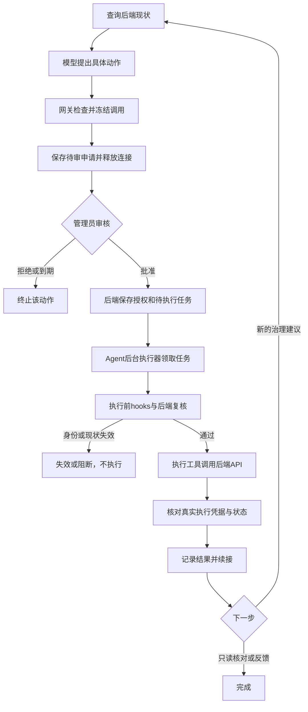

# 治理工具执行 Loop 与安全 Hooks 实施计划

> **状态：2026-10-30 用户授权实施至GL-05；GL-01A/02A/03/04/07/05本地实现和相关自动化验证已完成。GL-01B/02B真实MySQL验收与GL-06真实环境验收尚未完成。** 不授权执行真实治理、迁移真实数据库或部署。批次记录见 `docs/Agent层验证记录/GL-05审批界面与批次收尾.md`。
> **For agentic workers:** 使用 `executing-plans` 按任务实施；每项先验证反例，再实现、检查并小步提交。未经用户要求，不启动子 Agent。

**Goal：** 管理员批准具体治理动作后，由受控执行器调用 tools 封装的后端 API，核验结果并续接有界 loop；统一执行安全 hooks，阻断越权、审批替换和重复治理。

**Architecture：** 保持 AI SDK 7、Hono Agent、FastAPI 业务后端及既有治理 service。后端保存审批、执行授权和任务状态；Agent 执行器经唯一工具网关调用白名单内部 API。人工批准与业务执行拆分，后端继续承担最终授权、事务和幂等校验。

**Tech Stack：** TypeScript、Vercel AI SDK 7、Hono、Zod、FastAPI、SQLAlchemy、Alembic、现有数据库。首版不引入 LangGraph、WorkflowAgent、Redis 或新队列服务。

## 1. 依据与全局约束

已阅读：根目录 `AGENTS.md`、`specs/constitution.md`、`specs/plan.md`、`docs/Approvals设计与迭代记录.md`，并核对工具注册、角色工具、计划执行、审批路由、持久审计、后端审批与管理处置代码。

宪法约束原文：

- C-05：“三服务分离，Agent 不直接连库”。Agent 只能通过 FastAPI `/internal/agent/*` 白名单接口访问数据。
- C-07：个人记忆按账号隔离、可清空。学生/教师默认浏览器保存；2026-10-29用户新增管理员例外：管理员个人记忆和会话保存在服务器，中台来源会话独立目录与授权。私人会话存储不等于共享记忆，不把JWT、密钥或完整聊天写入治理恢复上下文。
- C-08：“Agent 运行可追踪”。每次运行、工具调用和审批至少关联 trace id、agent_run_id、调用摘要。
- C-06：普通工具和 MCP 工具必须显式白名单注册。
- 后端 `ruff check .`、前端/Agent `eslint` 必须零 error；核心流程必须有测试；界面文案使用简体中文。

### 已确认的方向

1. 用户最新说明：“治理应该是管理员审批通过后直接调用 tools 里面的后端 API 直接做”，该过程为 loop。
2. 审批前停止相关工具并释放连接；后台巡检、其他会话继续工作。
3. 服务身份和实际用户权限均由后端校验，不能让模型、提示词或客户端字段授予权限。
4. 已执行动作不得因恢复或重试重复执行；目标变化须重新核对，不能复用旧批准。
5. 外部 MCP 不提供人工批准工具。管理员全站权限不开放他人私人记忆和聊天。

### 已批准的五项建议

1. 采用“审批持久化＋后端任务表＋Agent 后台执行器”，不依赖管理员浏览器持续在线，也不长期保存管理员 JWT。
2. 首批只改治理动作的审批执行通道；教师名单和经验发布保留现有业务流程，但工具调用接入同一安全网关。
3. 审批只批准一次冻结调用；后续 loop 新提治理动作，必须另行审批。
4. 首版保存确定性的治理续接步骤，不承诺任意模型计划跨进程完整恢复。
5. 对旧工单保留原执行语义；新增版本化契约，避免旧前端和新执行器同时处置同一申请。

用户已明确批准以上1～5项；同时确认高风险调用在管理员端弹出批准清单后才放行。审批仅对应单次冻结调用，不把一次批准变为整段loop的无限授权。决策同步到spec/plan/tasks/analyze和Approvals记录，任务完成状态仍以实现与验证为准。

### 新增确认：管理员记忆/会话服务端保存，来源分区

用户选择“管理员个人记忆和会话也迁到服务器；其他角色不变”，并补充“单独分区，管理员和通过大系统中台接入的会话信息存在不同的文件夹”。

- 审批、执行任务、租约、审计等结构化业务数据继续由后端数据库保存，其持久数据卷位于服务器磁盘；不替换已有业务数据库。
- 管理员私人记忆和聊天历史改由后端管理服务器文件存储，管理员浏览器不再作为这些数据的持久真值源；退出或切换账号清理前端在途数据，不默认删除服务端历史。
- 中台接入会话使用另一目录树，不因映射到相同管理员账号而继承管理员私人记忆；不同中台客户端和账号继续细分命名空间。
- “分区”落实为受控独立目录/存储命名空间；不执行操作系统磁盘分区、格式化或移动现有业务盘。
- 学生/教师个人记忆与会话仍按原浏览器方案，不扩展云同步；本项不改变其账号隔离。

建议后端受控根目录 `PRIVATE_CONTEXT_ROOT`（与教材目录、静态资源目录分开），布局为：

```text
PRIVATE_CONTEXT_ROOT/
  admin/u_<backend_user_id>/
    memory.json
    sessions/<server_session_id>.json
  platform/c_<server_client_namespace>/u_<backend_user_id>/
    sessions/<server_session_id>.json
```

目录名和session_id均由后端生成或从已校验记录映射；客户端不得传目录路径或自报source/client_id。中台命名空间使用稳定内部标识，不使用原始密钥作文件名。后端在读写前同时核验来源、账号、客户端与会话归属，不能只靠文件夹命名隔离。

管理员登录JWT固定进入admin来源；中台密钥固定进入platform来源。人类管理员审核中台发起的治理时，只读取待审动作和必要证据，不因此开放中台完整会话。中台首版仅保存其会话信息，不自动创建或共享管理员memory.json。

后端负责schema、敏感信息拦截、大小限制、版本号和原子文件替换；同一命名空间的并发更新使用后端锁及版本比较，返回冲突而非静默覆盖。文件库不置于公开静态路由；Agent只通过FastAPI白名单读取，不直接打开私人文件。

保留现有记忆条目约束和会话请求预算。仅保存用户/助手可见消息及必要状态，不保存JWT、lease、服务凭证或隐藏推理。管理员支持查看、删除、清空本人记忆/会话；中台只能访问和清理本客户端/账号的会话。清空后不得继续注入，迟到响应不能恢复已清内容。

旧管理员浏览器记忆/会话不静默上传：首次使用服务端存储时提供可审查的本人数据导入选择，或使用空的新存储；管理员明确选择后才导入，按稳定迁移标识去重，成功回执后再提示清理旧本地副本。不把浏览器旧数据误说为已在服务端存在。

## 2. 当前实现与缺口

| 当前代码 | 实际行为 | 本轮变化 |
| --- | --- | --- |
| `agent/src/tools/role-actions.ts` | 模型只能提议治理、读取结果 | 保留模型工具；新增仅受控执行器可用的执行工具 |
| `agent/src/tools/registry.ts` | 仅放行 low 工具；没有获批高风险执行通道 | 保持模型注册表限制，新增独立执行注册表与统一网关 |
| `agent/src/loop/plan-executor.ts` | 白名单/参数/预算/审计检查，遇待审动作退出 | 复用网关，显式返回 waiting，而非将部分计划等同全部完成 |
| `backend/.../service_admin.py` | 前端 resolve 确认时直接调用治理 service 处置 | 新契约中 approve 只批准；执行改由 worker 的工具调用触发 |
| `backend/.../service_waits.py` | resume 只消费已执行结果 | 保留旧版；新执行任务支持查询、结果核对和有界续接 |
| `agent/src/mcp/admin-tools.ts` | 独立校验后直接进入提议/查询逻辑 | 工具调用也经过统一网关，不新增批准入口 |

已有身份、角色、范围、参数、预算、取消和审计检查并非缺失；问题是检查分散，且没有“批准后执行”的统一生命周期。现有 `beforeStep/afterStep` 是审计回调，不能当成完整安全 hooks。

## 3. 目标流程及边界



- 审批后执行冻结参数，模型不再生成或修改该动作参数。
- 治理范围沿用现有已实现白名单：隐藏、删除、警告及现有封禁类型；不新增正文、账号资料或身份修改。
- 正常退出、拒绝、过期、取消和安全阻断都是明确状态；不能用无限重试掩盖失败。
- 新流程不改变原始帖文、私聊或个人记忆的数据隔离。
- 本轮不实现全套 RAG、跨设备会话、通用工作流引擎或任意脚本恢复。

## 4. 批准与执行的后端契约

下列契约已在GL-01～05接入OpenAPI与客户端；领取/执行默认关闭，不代表已在真实环境启用。

| 接口 | 凭证与调用者 | 职责 |
| --- | --- | --- |
| `POST /api/governance/approval-requests/{request_id}/approve` | 人类管理员 JWT | 校验当前身份、冻结参数和目标；仅批准并同事务写待执行任务 |
| `POST .../{request_id}/reject` | 人类管理员 JWT | 拒绝未执行申请 |
| `POST .../{request_id}/cancel` | 人类管理员 JWT | 锁定后取消未执行批准，不撤回已提交动作 |
| `POST /internal/agent/governance-executions/claim` | 专用执行器服务凭证 | 领取已经人类批准的任务，返回短期 lease；不创建批准 |
| `POST /internal/agent/governance-executions/{execution_id}/execute` | 执行器服务凭证＋匹配的 lease | 后端读取授权与冻结参数，复用业务 service 执行一次 |
| `GET /internal/agent/governance-executions/{execution_id}` | 执行器服务凭证＋任务 lease | 核对该任务状态和真实执行结果，不暴露其他账号私有运行 |
| `POST /internal/agent/governance-executions/{execution_id}/report` | 执行器服务凭证＋任务 lease | 保存续接成功、失败或待核对状态，禁止改写业务执行结果 |

### 身份与最小授权

批准操作继续使用服务端可验证的人类身份；外部密钥、模型输出和执行器服务凭证都不能自行批准。

长期等待后不能复用或持久保存审批时的 JWT。建议新增明确的“已批准动作执行授权”：后端关联申请、实际申请来源、批准人、冻结调用、期限及唯一执行标识；领取任务后签发不进入模型的短期不透明 lease，后端只存其哈希和到期时间。lease 使用密码学安全随机数生成。

**这是一条新增的专用认证契约，需要本次审查认可。** 它不把现有普通服务 token 升格为管理员：只允许专用执行器领取并执行已批准任务；每次执行仍查当前批准人有效性、管理员角色、申请来源有效性和当前资源权限。外部凭证被撤销或映射主体失效时，其待执行申请进入 blocked，不继续执行。普通 `/user/*` 内部接口继续原有双凭证校验。

lease 不进入提示词、浏览器 localStorage、MCP返回或日志。任务领取使用租约版本 `lease_epoch`；过期领取者不能凭旧租约启动新的执行或覆盖新领取者的结果。管理员更改身份、取消批准或目标变化后，旧授权失效。

### 审批绑定字段

后端持久保存：`request_id`、`execution_id`、`contract_version`、`tool_name`、规范化动作参数、`args_hash`、`target_version`、申请人/来源、`approved_by`、`approved_at`、`expires_at`、状态、执行回执以及 trace/run 关联。

参数先通过后端 schema，再按固定字段、稳定键序和确定的默认值序列化后计算 SHA-256。审批界面展示的就是该规范化调用。哈希是防错配标识，不代替后端认证或数据库记录。

执行请求只提交执行标识和受控租约，不接受模型或浏览器重新传入动作、目标、期限或操作者身份。后端从冻结记录读取这些字段。

默认7天沿用现有等待政策：新动作首次执行前仍检查申请有效期；到期不启动处置。过期、取消不撤销已经提交成功的治理。执行已进入事务后，取消不能承诺中止或撤回，界面应显示“正在执行，结果待核对”。

## 5. 状态、事务与恢复

### 业务申请状态与运行状态分开

业务申请保存 `pending → approved → executed`，或进入 `rejected/cancelled/expired/invalidated/blocked`。`approved` 只表示获准，不表示处置完成。

后台任务保存 `queued → claimed → verifying → completed`；可进入 `result_unknown/failed/blocked`。现有 moderation_case 状态不直接批量重命名；新增申请/执行记录映射到原工单，处置成功后仍按现有规则写工单 executed。

执行接口处理期间可对外显示 executing，但它不是“已执行”的回执；客户端以数据库内与业务修改同事务提交的回执为准。

### 关键事务边界

1. **批准事务：** 锁申请、复核权限和现状、记录批准、写唯一待执行任务，同事务提交。重复批准返回同一任务；两位管理员并发批准不能产生两次执行授权。
2. **领取事务：** 原子领取一个可执行任务并更新租约；租约只协调领取，不是“执行一次”的最终保证。
3. **执行事务：** 锁定申请/执行记录，复核租约与授权；已有回执则返回原回执；否则复核目标、执行既有治理业务、写执行回执及必需审计/通知记录，再一次提交。业务修改与 executed 回执不得分两次提交。
4. **反馈阶段：** 根据回执更新 Agent 运行记录和反馈。反馈或外围审计失败，不把已经执行的业务重新标为未执行，不再次处置。

当前 `resolve_moderation_case` 存在分步提交路径，实现时必须先提取可由同一事务调用的治理用例：repository 只 flush；旧入口继续原语义，新执行接口在最外层提交。不能简单包一层工具后声称满足原子性。

### 超时与进程异常

- 请求发送后断线：进入 result_unknown，先查询同一 execution_id 的回执；没有权威结论时不宣称成功或失败，也不换新ID重做。
- 后端事务未提交就崩溃：业务和回执一起回滚。同一执行标识再次请求，由后端锁和幂等判断处理。
- 已提交但响应丢失：重复请求只返回原回执。
- Agent领取后崩溃：租约到期可重新领取；业务接口继续按同一执行标识去重。
- 后端事务仍执行中：查询可返回进行中；有限退避核对，不把暂时没有回执当作安全重做依据。
- 后台默认每5秒领取，单实例最多1项处置在途；请求超时沿用60秒。结果核对最多3次，间隔2/5/10秒，仍未知则保留待核对并展示人工检查入口，不自动生成新执行申请。
- 人工等待不计入单次运行180秒活动预算；批准后建立关联的 continuation run，使用现有活动预算。原有累计工具/返工使用量持久保存，不因恢复清零；首版每条根任务最多提出3次治理申请，达到上限转人工，不无限自循环。

## 6. 统一工具网关与安全 Hooks

### 单一调用入口

新增 `agent/src/tools/execution-gateway.ts`，聊天计划、SDK工具适配、后台巡检、MCP和批准执行器均通过网关。现有 HTTP 身份中间件和后端授权保留。不得只在聊天路由包一层，让MCP或恢复路径继续直接调用工具。

新增 `agent/src/security/hooks.ts`：确定性安全策略编排。Hook可以阻断或要求审批，不调用模型授予权限；异常、依赖不可用或无法确认状态时 fail closed。获准参数不可由hook静默修改；需要修改就重新预览申请。

```ts
type InvocationSource = "chat" | "patrol" | "mcp" | "approved_worker";
type GateDecision =
  | { kind: "allow" }
  | { kind: "require_approval"; reason_code: string }
  | { kind: "deny"; reason_code: string };

interface FrozenCall {
  execution_id: string;
  tool_name: string;
  args_hash: string;
  target_version: string;
}
```

这组接口为计划契约；实际可信身份和lease由服务端上下文提供，不接受模型构造。模型注册表只展示读取和提议工具；独立 `approved-actions.ts` 执行注册表不进入工具说明或 `toSdkTools`。

| Hook | 必须检查 | 拒绝后的行为 |
| --- | --- | --- |
| beforePlan | 后端有效身份、任务课程/目标、允许工具、可信规则版本 | 停止规划；不按用户文本切换身份 |
| beforeToolCall | 白名单、角色/资源范围、schema、预算、取消、当前规则 | 禁止发送HTTP调用；写脱敏拒绝原因 |
| beforeApproval | 真实现状、动作合法性、规范化参数、目标版本、期限 | 不创建可执行授权 |
| beforeApprovedExecution | 人类批准、当前双方身份/来源、租约、参数绑定、目标状态、幂等状态 | blocked/invalidated；不执行替代动作 |
| afterToolCall | 响应schema、关联ID、目标、动作、回执和执行终态一致性 | 结果不进入成功证据；写待核对或失败 |
| beforeResume | 任务归属、终态、过期/取消、当前权限、剩余预算 | 不恢复；不得重复执行已完成动作 |
| beforeOutput | 引用真实性、结果与回执一致、隐私与凭证脱敏 | 拒绝错误成功声明，不展示敏感字段 |
| onError | 已执行/未执行/未知区分、重试预算、审计状态 | 无静默降级放行，无越权fallback |

高风险执行前的必需审计写入失败时不调用业务；业务提交后外围审计失败只能补记反馈，不能以重试审计为由重放业务。Hook事件记录固定原因码与关联标识，禁止写JWT、lease、完整私人输入或无界工具正文。

检索正文和工具返回均是不可信数据：不允许它们注册工具、改变审批、修改规则或触发另一个写操作。输出schema与来源检查提供边界控制，不宣称能完美识别所有提示注入。

## 7. Loop续接范围与兼容性

首版续接阶段固定为 `verify_result → report_result → next_proposal_or_finish`。持久保存阶段、根任务ID、申请/执行ID、工具/返工消耗、轮次和最小目标引用，不保存可执行代码、任意闭包、管理员JWT、个人记忆或完整聊天。

结果核对完成后，需要继续巡检时由服务器在原任务范围内重新读取当前状态；新的模型建议不继承上一动作批准。若重新生成反馈需要私人会话上下文，则由用户重新进入该会话后提供，不从后端恢复他人私聊。

采用版本化 `contract_version=2`：

- 旧版等待和已executed工单继续只读/反馈，绝不转成新的待执行任务。
- v2申请的旧resolve入口必须拒绝实际处置并提示使用新批准流程，避免前端和worker双路径执行；管理员普通手动治理和历史工单保持原行为。
- 新前端区分“待审批、已批准待执行、执行中、已执行、结果待核对、已失效”；高风险动作在管理员端弹出目标、动作、期限、影响及冻结参数清单，明确批准后才放行，关闭弹窗不视为批准。批准请求成功不展示“治理成功”。
- 7天过期、拒绝、取消按新授权重新校验；已执行动作不撤回。
- 先用 `GOVERNANCE_EXECUTOR_ENABLED=false` 上线后端兼容契约；开启后才生成v2申请。关闭开关停止新v2提议和新领取，仍可核对在途结果；旧v1保持原流程。不得退回旧入口执行未完成v2。
- MCP保留预览、申请和查询；worker执行工具与批准接口不注册外部MCP。

## 8. 实施任务与文件边界

仓库基准目录：`D:/软件工程及素养/class/workplace`。以下文件路径相对此目录；“新建”为拟新增文件。

实施顺序：GL-01 → GL-02 → GL-03 → GL-04 → GL-07 → GL-05 → GL-06。GL-07是本次审查追加的独立存储任务，其编号保留追加顺序；最终故障验收在全部接线之后进行。每项验证提交后按仓库要求提供审查记录，不因设计获批自动将整个实施批次标完成。

### GL-01：规格、状态与后端批准契约

修改：`specs/constitution.md`、`specs/spec.md`、`specs/plan.md`、`specs/tasks.md`、`specs/analyze.md`、`docs/Approvals设计与迭代记录.md`、`docs/Memory设计与迭代记录.md`。

新建：`campus-overflow-ai/backend/app/modules/governance/schemas_executions.py`、`router_executions.py`、`service_executions.py`，以及 `backend/tests/test_governance_approvals_v2.py`。

修改：governance现有 `domain.py`、`models.py`、`repository.py`，主路由注册，以及新增一条 Alembic 迁移。新状态、唯一execution_id和request_id约束、任务租约及索引均由后端持久化，不由Agent创建数据库连接。

- [x] 用户已批准五项建议及管理员存储例外，回填需求、C-07修订、A-D11/M-D13决策，先做一致性分析；不把文档确认等同于后端契约交付。
- [x] 先写反例：批准后目标仍未变化、重复批准只生成一项任务、普通用户/外部密钥不能批准、过期与状态变化拒绝。
- [x] 执行 `.venv/Scripts/python.exe -m pytest tests/test_governance_approvals_v2.py -q`，确认新增契约用例先失败。
- [x] 实现approve只记录授权和任务，返回 `approved`、执行标识和查询入口，不调用处置service。
- [x] 相关8文件148 passed；临时SQLite升级→降级→再升级，检查唯一约束；不触碰真实业务库。
- [ ] 独立MySQL测试库升级→降级→再升级与双连接并发验证；本机Docker引擎未运行，未将SQLite结果替代此项。
- [x] 记录本块验证并随本批本地提交 `feat: 增加版本化治理批准与执行任务契约`，不推送。

### GL-02：后端原子执行、幂等与旧入口隔离

修改：governance `service_executions.py`、`service_admin.py`、`service_internal.py`、`service_approvals.py`、`repository.py`、`service_notify.py`，以及现有qa/identity公开service中需要提供无内部commit的治理用例边界。

新建测试：`backend/tests/test_governance_execution.py`、`test_governance_execution_concurrency.py`。

- [x] 先写反例：服务凭证单独不能执行、旧lease/改参数/撤权拒绝、v2不能走旧resolve、两次执行只改一次、通知失败事务回滚。
- [x] 用 `.venv/Scripts/python.exe -m pytest tests/test_governance_execution.py -q` 观察反例失败；补充旧身份缓存反例，先复现再锁定刷新。
- [x] 提取可组合事务的治理用例，执行入口锁记录并同事务提交业务、回执和必需审计；重复调用返回原回执。
- [x] 复用批准记录中的身份和参数，不能接受调用者自报role；已有v1 executed直接返回旧结果，不导入队列。
- [ ] 运行执行与原审批/申诉/身份回归；独立MySQL双连接测试并发批准、并发执行、lease过期和回滚，不能把SQLite通过当作该项完成。
- [x] 记录验证，小步提交 `feat: 接通获批治理的原子执行与幂等回执`；GL-02A本地实现待审查，GL-02B真实MySQL验收保留未完成。

### GL-03：统一安全网关与入口覆盖

新建：`agent/src/security/hooks.ts`、`security/contracts.ts`、`tools/execution-gateway.ts`；`agent/tests/tool-security-hooks.test.ts`、`tool-gateway-entrypoints.test.ts`。

修改：`agent/src/tools/registry.ts`、`tools/role-actions.ts`、`agents/controller.ts`、`loop/plan-executor.ts`、`loop/planned-tools.ts`、`mcp/admin-tools.ts`、`mcp/tools.ts`、调用工具的scheduler入口。保留现有身份/审计行为，迁移检查时逐项对照旧回归。

- [x] 测试入口矩阵：chat、SDK适配、patrol、MCP、approved_worker均可被同一deny策略拦截，并断言后端HTTP调用为零。
- [x] 运行 `node node_modules/vitest/vitest.mjs run tests/tool-security-hooks.test.ts tests/tool-gateway-entrypoints.test.ts`，确认先失败。
- [x] 定义GateDecision与固定原因码；网关按来源选择模型工具表或批准执行表，先完成hooks再调用工具。
- [x] 请求级身份由服务器注入；registry不能向模型泄露批准工具；hook不可静默改已审批参数，策略异常默认拒绝。
- [x] 上述测试及既有role-action、main-agent-control、mcp-admin、plan-executor相关回归通过；`tsc --noEmit`、`eslint .`通过。
- [x] 记录验证，小步提交 `feat: 统一工具执行网关与安全生命周期检查`。

### GL-04：受控执行工具与可恢复后台任务

新建：`agent/src/tools/approved-actions.ts`、`scheduler/governance-executor.ts`、`approvals/continuation.ts`；`agent/tests/approved-actions.test.ts`、`governance-executor.test.ts`。

修改：`agent/src/internal-client.ts`、`config.ts`、`server.ts`、`routes/approvals.ts`。后端增加配置验证与任务claim/report契约。

- [x] 先写反例：无lease零执行、来源非approved_worker零执行、响应丢失先查询、不重复处置、旧worker不能覆盖新租约。
- [x] 执行 `node node_modules/vitest/vitest.mjs run tests/approved-actions.test.ts tests/governance-executor.test.ts`，确认先失败。
- [x] 工具只接收execution_id；可信lease留在服务端上下文，内部client发送专用凭证；响应按schema和冻结调用匹配后才进入成功证据。
- [x] 用后端任务表实现领取/租约、有限结果核对及最小continuation；不把长时间等待表示为未结束Promise，不由worker注册人类批准工具。
- [x] 原请求退出不取消已批准后台任务；后台服务正常关闭停止领取并释放本地资源；后端任务仍可由重启实例核对续接。
- [x] 相关测试、取消/预算/审批等待回归、类型和lint通过。
- [x] 记录验证，小步提交 `feat: 接通获批工具执行与治理循环续接`。

### GL-05：审批界面与新旧行为隔离

修改：`frontend/src/api/governance.ts`、`features/admin/ApprovalCenterView.tsx`、`ApprovalRequestPanel.tsx`及对应测试，按现有类型组织补请求/状态类型。

- [x] 先写反例：点击v2批准只发送approve、不发旧resolve；批准响应不显示“已执行”；结果未知不能再次发送新动作；v1保持原流程。
- [x] 执行 `node node_modules/vitest/vitest.mjs run src/features/admin/ApprovalCenterView.test.tsx src/features/admin/ApprovalRequestPanel.test.tsx`，确认新增断言先失败。
- [x] 高风险工具必须弹出冻结清单，由管理员明确点击批准；展示批准人、有效期、后台执行状态和查询入口；参数变化引导重新申请，账号退出停止前台查询且不泄露旧结果。
- [x] 仅管理员人类界面提供批准/拒绝；MCP调用无此入口。错误信息区分权限拒绝、目标过时、执行未知和已执行。
- [x] 相关测试、类型、eslint和前端规则检查通过。
- [x] 记录验证，小步提交 `feat: 区分治理批准与后台执行状态`。

### GL-06：故障注入、验收与发布开关

新建：`agent/tests/governance-loop.integration.test.ts`；`docs/Agent层验证记录/GL治理Loop与安全Hooks.md`。修改Agent approvals/tools/scheduler README与运行配置说明。

- [ ] 自动化验证：批准前零执行；批准后冻结调用执行一次；重复事件、两worker、过期lease、响应丢失、提交前/后崩溃、恢复撤权、审计失败、篡改参数、注入工具返回，均产生预定状态。
- [ ] 对chat、MCP、patrol和恢复入口逐项证明不能绕过网关；不只测试hook函数本身。
- [ ] 独立MySQL验证跨连接锁和事务；实际启动Agent/FastAPI进程，杀掉领取者后重启，检查执行次数、回执和trace关联。无真实治理数据，使用专用测试账号与测试内容。
- [ ] 三服务全量测试与lint通过；两个TS服务类型通过，后端分层5契约通过；记录所有跳过项及原因，未跑项目不得填写通过。
- [ ] 默认关闭新执行器，核验开/关切换、旧待审工单与在途v2任务的处理行为；不自动迁移旧工单、不自动批准。
- [ ] 更新任务状态与决策记录，提交 `test: 验证治理循环故障恢复与安全边界`。用户允许推送时按提交顺序上传；不自动合并PR或部署。

## 9. 验收矩阵

| 场景 | 必须观察到的结果 |
| --- | --- |
| 学生或教师请求管理员治理工具 | 入口/后端拒绝，实际处置次数0 |
| MCP伪造approve或execute工具名 | 未注册，实际处置次数0 |
| 管理员批准一次 | 工具调用冻结后端API，实际处置次数1 |
| 参数/目标/期限被替换 | 审批绑定失败，实际处置次数0 |
| 批准后管理员被降权/封禁、外部来源撤销 | 执行前blocked，不沿用旧快照授权 |
| 两管理员批准、两worker领取或重复恢复 | 唯一执行记录，实际业务变化不重复 |
| 后端提交成功但响应丢失 | 按原execution_id查回执，不新建动作 |
| 必需审计/通知写失败 | 业务同事务回滚，无假executed |
| 已提交后外围反馈审计失败 | 业务保留executed，补记反馈不重做 |
| 等待7天到期或执行前取消 | 不启动新处置；已执行动作不撤销 |
| 一个工单等待 | 前台聊天及无依赖巡检继续 |
| 输出含假成功/敏感凭证/越权指令 | 不进入可信证据和成功反馈，不扩大权限 |
| 故障重启后继续 | 恢复确定性阶段和剩余预算；不承诺任意原模型计划完整恢复 |

### GL-07：管理员服务端记忆/会话与中台来源隔离

本项是用户审查新增范围，与治理任务表分开交付；管理员存储前后端契约完成后再切换聊天接线。GL-03必须覆盖来源校验，GL-06最终验收包含本项。

拟新建后端文件：`backend/app/modules/governance/schemas_contexts.py`、`router_contexts.py`、`service_contexts.py`、`context_files.py`；测试 `backend/tests/test_private_contexts.py`。均位于 `campus-overflow-ai/` 下。文件访问集中在context_files，不混入Agent或路由；账号认证、实际客户端映射与授权在后端service校验。

拟新增前端 `frontend/src/features/agent-chat/server-sessions.ts`、`frontend/src/features/me/server-memory.ts`及对应测试；修改 `frontend/src/api/agent-chat.ts`、聊天入口、MemoryPanel与session-store，在已验证role/source下选择存储适配器。修改Agent `src/internal-client.ts`、请求上下文与MCP会话接线，仅服务端派生来源。后端配置增加PRIVATE_CONTEXT_ROOT与对应目录访问验证。

- [x] 先写反例：同一user_id的admin与platform互不可读，不同platform客户端互不可读；请求伪造source/client_id、路径逃逸、会话归属不符全部拒绝；输出不泄露磁盘路径。
- [x] 执行 `.venv/Scripts/python.exe -m pytest tests/test_private_contexts.py -q`，确认新增契约先失败。
- [x] 实现后端来源绑定、账号与会话授权、独立文件目录、版本比较与原子写入；凭证只用于认证不进入持久数据，文件损坏不自动作为空文件覆盖。
- [x] 实现管理员记忆/会话的后端列表、读取、写入、删除/清空与Agent内部按需读取；中台会话仅允许来源所属客户端访问，管理员教学全站权限不能旁路私人数据隔离。
- [x] 前端存储适配测试先红后绿：管理员刷新后从服务器恢复，教师/学生仍走原浏览器；账号切换取消旧请求；清空后旧响应不回写；旧浏览器数据必须显式选择后才导入，不默认上传。
- [ ] GL-06真实环境补验：进程重启、备份/恢复目录及跨进程故障；本地并发版本冲突、文件持久读取、前端/Agent类型/lint与后端分层已验证。
- [x] 记录验证，小步提交 `feat: 隔离管理员与中台的服务端会话和记忆`；若后端与前端分别完成，分别验证提交，不攒成一次大改。

## 10. 用户审查结论与交付边界

2026-10-29：用户批准本文五项建议；明确高风险管理员弹窗批准后放行。补充管理员个人记忆和会话也保存在服务器，管理员与中台来源会话置于不同文件夹，学生/教师沿用浏览器方案。

2026-10-30回填：GL-01A/02A/03/04/07/05已本地实现，包含专用worker、冻结清单弹窗、取消与服务器私人上下文。新通道仍默认关闭；GL-01B/02B真实MySQL及GL-06真实进程/部署验收待完成，不把SQLite、mock或本地单服务通过写成真实环境已验收。尚未推送、迁移真实业务库或部署。
