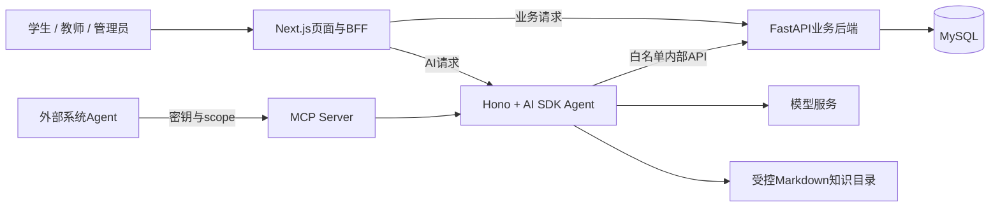

# CampusOverflow AI 面试复习稿

> 整理日期：2026-10-29。面向项目介绍、技术追问与设计复盘。
> 依据本地代码及最新用户决策整理。本地基线为 `402365b`；不代表两个远端的最新状态。
> **已实现**表示有代码及相关自动化验证，**已确认设计**表示方案已认可但代码尚未落地，**展望**表示后续评估方向。面试时务必区分这三种状态。

## 0. 先记住这六句话

1. 项目是面向高校课程的问答与教学协作平台，AI承担检索、归纳、建议和风险预警。
2. 前端负责交互，FastAPI是业务规则与权限的权威，Agent负责受控的模型规划和工具执行。
3. 模型可以建议“做什么”，程序和后端决定“能不能做、怎么做、是否执行过”。
4. Loop受步数、工具次数、时间、自检和人工审批约束，不允许无限自主执行。
5. 教材RAG采用分层卡片、混合召回、精排和有限概念扩展；目前目录已落地，完整检索链仍属设计。
6. 审计持久化不等于任意工作流可恢复；单元测试通过也不等于真实生产验收完成。

## 1. 可以直接口述的项目介绍

### 1.1 约一分钟版本

> 我参与的是CampusOverflow AI，一个面向高校课程的问答与教学协作平台。它解决的是群聊答疑难沉淀、重复问题多、优质答案难复用，以及教师难以汇总学习问题这几个问题。
>
> 系统分成Next.js前端、FastAPI业务后端和TypeScript Agent三个服务。后端负责账号、课程、问答、声誉和治理规则；Agent通过白名单API进行检索、生成建议和教学分析，不能直接连接业务数据库。
>
> 项目里我重点关注的是受控Agent：模型生成计划，程序校验工具、参数、权限和预算，执行后进行来源检查和有限自检。高风险治理必须人工确认，并且要保证重复请求或恢复不会重复处置。
>
> 目前主业务和受控运行主干已落地。完整教材RAG、审批后由工具执行器续接的新版治理loop，以及管理员服务端私人上下文存储，是已形成设计、继续推进的部分。

这段中的“我重点关注”可以用于说明你的设计参与；具体代码作者和负责模块必须按真实分工介绍，不把整个团队或AI辅助完成的工作都说成独立手写。

### 1.2 约三分钟版本的展开顺序

1. **场景：** 课程群答疑碎片化，重复提问，高质量回答不能形成长期资产。
2. **业务闭环：** 提问—回答—采纳/认证—知识复用；教学反馈—周报—教学调整；风险预警—审批—处置—申诉。
3. **系统边界：** 三服务分工、前端BFF、后端模块化单体、Agent只走后端白名单。
4. **技术重点：** 结构化规划、受控工具执行、来源检查、有限返工、审批与幂等。
5. **取舍：** 先做可控闭环，不为了多Agent、知识图谱或向量数据库堆技术。
6. **进度边界：** 说明已实现和新设计各是什么，最后用一个具体难点展开。

## 2. 总体架构：三服务分离，业务后端仍是模块化单体



图中的MCP是Agent服务内的对外接口能力，不代表额外部署了第四个独立业务服务。知识目录是受控公共/课程资料，不能与私人上下文目录混用。

| 服务 | 技术 | 职责与边界 |
| --- | --- | --- |
| 前端 | Next.js 16、React 19、TypeScript、Tailwind、Zustand | 三角色页面、表单、状态展示、SSE消费、同源BFF；不作为最终权限裁决者 |
| 后端 | FastAPI、Pydantic、SQLAlchemy 2、Alembic、MySQL | 身份与角色、业务规则、事务、数据范围、治理执行、审计持久化 |
| Agent | TypeScript、Hono、Vercel AI SDK 7、Zod、MCP SDK | 模型接入、结构化规划、受控工具、生成与自检、后台任务 |

**为什么拆开？** 业务授权和数据库事务不依赖模型是否可靠；模型接口变化、调用慢或不可用时，可以控制AI功能降级，让核心问答业务继续使用。三服务也便于分别测试和部署。

**为什么不说“六个微服务”？** identity等六个模块同属FastAPI进程，属于模块化单体。模块边界和服务部署边界不是同一件事。

## 3. 前端：交互、BFF和真实状态表达

### 3.1 目录与角色页面

- `src/app/`：App Router文件路由，普通页面、`teacher/*`、`admin/*`。
- `src/features/`：按业务组织问题详情、课程管理、审批、聊天、个人记忆等组件。
- `src/api/`：业务与Agent请求封装，统一响应和错误处理。
- `src/shared/`：通用组件、类型、状态和基础工具。

角色守卫负责减少误操作和错误页面请求；真正授权仍在后端。即使绕过页面直接请求接口，也不能获得教师或管理员能力。

### 3.2 BFF和登录链路

```text
浏览器提交登录表单
  → Next.js BFF转发给FastAPI
  → 后端验证账号并返回JWT
  → BFF把JWT写入HttpOnly Cookie，并从给浏览器的响应体中去掉token
  → 后续请求由BFF读取Cookie并向上游注入Authorization
```

登录用户信息放在Zustand内存状态中，实际凭证不交给React组件或存入localStorage。HttpOnly降低脚本直接读取凭证的风险，但不能据此声称XSS或CSRF问题全部解决；部署时仍需检查Cookie策略、来源验证和内容渲染边界。

Agent BFF不信任浏览器自报的Authorization、role或user_id，也不把浏览器任意请求头直接透传为服务凭证。

### 3.3 AI交互与SSE

当前聊天协议包括`meta / delta / done / error`。meta关联run和trace；error表示失败，连接结束不自动代表成功。

**一个值得主动说明的取舍：** 当前生成候选会先缓冲，经来源检查和自检通过后再发送文本。因此使用SSE并不等于用户一直能看到即时逐token输出。选择这条路径是为了避免先展示未经校验的内容，代价是首段等待时间增加。

账号切换、退出、清空或取消时，前端会取消在途请求并防止迟到结果写回旧账号会话。取消本地等待不等于外部模型已经停止计算，也不能撤回已经发送的数据。

### 3.4 页面状态必须表达真实业务状态

加载、空、失败、生成中、待确认、已执行需要分别展示。尤其“申请保存成功”“管理员批准成功”“治理执行成功”不能混用。

新版治理设计要求高风险弹窗展示冻结清单，管理员明确批准后放行；这项统一新通道尚未实现，不能把现有审批页面等同于新版完整闭环。

## 4. 后端：模块、分层、事务与权限

### 4.1 六个业务模块

| 模块 | 业务 |
| --- | --- |
| identity | 登录、用户、账号状态、角色、研究生与助教认证能力 |
| courses | 课程、成员、知识树、教学计划、教学周报 |
| qa | 问题、回答、评论、标签、采纳和回答认证 |
| interaction | 投票、声誉流水、通知 |
| discovery | 搜索、筛选和榜单等只读聚合 |
| governance | 风险工单、审批、申诉、Agent运行和内部API等 |

### 4.2 分层如何解释

```text
router → service → domain
             ↓
         repository → models → 数据库
```

| 层 | 负责什么 | 不应负责什么 |
| --- | --- | --- |
| router | HTTP参数、身份依赖、拆字段、调用用例和返回响应 | 直接写SQL或业务规则 |
| schemas | Pydantic输入/输出契约 | 数据库模型或业务执行 |
| service | 用例编排、授权、跨模块协调和事务边界 | 直接操作ORM模型或拼SQL |
| domain | 规则、状态迁移、不变量、领域异常 | FastAPI、SQLAlchemy、网络与文件I/O |
| repository | 查询、增删改和flush | 决定业务权限或自行commit |
| models | 表结构、约束、索引 | HTTP和业务编排 |

跨模块优先通过公开service调用。使用import-linter检查依赖约束，而不是仅在文档中要求“保持分层”。鉴权基础设施存在明确登记的豁免，不能声称整个项目绝无跨层例外。

**好处：** 接口变化尽量停在router/schema；纯规则可以不启动Web或数据库就测试；跨表事务放在用例层协调。涉及数据模型和业务契约的变化仍可能影响多层，分层不能保证任何修改都只动一个文件。

### 4.3 用一个事务例子解释工程能力

以投票为例，需要协调投票记录、目标分数、作者声誉和流水，不能每个repository各自提交。由service组织操作并统一commit，数据库唯一约束对同一用户/目标的重复投票兜底；涉及竞争的数据还需要锁与异常处理。

你可以说：“我把应用层检查、事务和数据库约束结合起来，而不是先查一下有没有记录就认为不会并发重复。”

不要说SQLite单元测试证明了MySQL所有并发情况；锁、隔离级别和连接竞争需要真实数据库专项验证。

### 4.4 身份、角色与资源范围分开

- 角色是student、teacher、admin。
- 助教不是第四种角色，而是研究生身份与助教认证状态组合形成的能力位。
- 教师管理本人负责课程；管理员继承全站教师业务并保留治理权限，但不自动继承学生专用能力或助教资格。
- 有效助教可以认证全站可见课程其他学生的回答，无需入课，禁止自我认证。
- 管理员全站教学权限不意味着可以读所有人的私人记忆、聊天和用户归属运行。

**认证**回答“是谁”；**授权**回答“能对哪个资源执行什么动作”。服务凭证只证明调用服务身份，不能代替操作者权限。

## 5. Agent Loop：模型规划，程序受控执行

### 5.1 现有主干

```text
请求进入 → 后端解析可信身份 → 创建请求级工具表与运行上下文
  → 模型生成结构化PlanList
  → 程序校验计划、参数、任务范围与预算
  → 顺序执行工具并记录本轮证据
  → 生成候选结果
  → 程序结构/来源检查 → 无工具模型审查 → 再次程序校验
  → 通过：确认终态并返回；允许的质量失败：有限返工；其他失败：停止
```

PlanList描述步骤ID、目标、工具名和参数。引用如`$s1.items[0].title`由程序解析为受限字段路径，不执行模型生成的表达式或代码。

**已有约束：** 每版计划最多8步；单次运行累计最多12次工具调用；结构修复与重新规划共用1次返工预算；单次上游调用通常60秒、运行活动预算180秒。返工不重置工具次数和时间预算。

401/403、非法计划、审计失败、取消/超时或异常模型结束不能假装成“再试一次就好”的质量问题。必须终止或给出明确失败，不降级为更高权限身份。

### 5.2 为什么叫loop，而不是固定提示词链？

模型会基于任务制定计划，工具返回影响候选生成；检查不通过时可以携带固定反馈重新规划。但循环有硬预算和终态。固定链条强调预定步骤，受控loop允许有限调整，同时把执行权留给程序。

当前计划执行器以顺序执行为主，中间结果保存在内存Map。不要把它说成已经支持任意动态DAG、分布式多Agent调度或完整断点恢复。

### 5.3 来源检查与模型自检不是同一件事

程序核对本轮实际查询到的问题/答案ID、标签、课程和链接，阻止凭空捏造站内引用。模型审查负责检查切题、完整和证据语义，但可能误判。

审查器没有工具，不允许修改权限或执行治理，只输出通过与固定问题代码。来源格式检查不等于所有自然语言事实都已证明；模型自检也不等于答案保证正确。

### 5.4 主Agent和用户上下文如何理解

主Agent负责共享目录、行为规范、回答流程经验、工具分配规则和认证问答链接入口。每个用户使用隔离的会话执行上下文，共享服务实例不等于共享私人历史，也不要求为每个用户创建操作系统线程。

主Agent记忆不装下全部教材；教材正文通过知识目录和未来RAG读取。全局回答经验由Agent提交建议，教师/管理员审核发布，不能把任意聊天自动提升为全局经验。

工具能力受到固定角色上限、主规则和后端当前资源权限共同约束。主Agent只能在授权范围内分配能力；撤权或规则收紧后，旧工具引用也不能继续绕过检查。

## 6. 治理Loop：当前实现与已批准新设计必须分开

### 6.1 当前代码已经具备什么

```text
Agent查现状并提交冻结申请 → 等待并释放连接
  → 管理员在前端确认 → 后端resolve执行治理
  → Agent读取已执行结果并作幂等反馈
```

已有待审申请、默认7天等待、拒绝/取消/过期、现状版本核对和结果消费。已执行动作不能通过resume再做一遍。

**局限：** 当前resume主要是结果反馈，不是恢复原模型计划的任意后半段。审批状态和审计持久化不等于完整运行栈持久化。

### 6.2 新版设计：已获批准，尚未实施

```text
查询现状 → 提议具体调用 → 安全检查并冻结清单
  → 管理员弹窗明确批准
  → 后端保存单次授权与待执行任务
  → 后台执行器调用tools封装的后端API
  → 核对回执 → 反馈/下一轮；新动作重新审批
```

“批准”只放行一次特定调用，不允许模型在批准后替换目标、动作、期限或参数。关闭弹窗不等于批准，外部密钥和模型声明也不能伪造批准。

后台执行器不长期保存管理员JWT。设计使用后端批准记录与短期任务租约，由专用内部接口校验；普通服务token不会因此获得通用管理员能力。租约负责协调worker，最终授权和幂等仍在后端执行事务中。

### 6.3 幂等、原子性和未知结果

应绑定request_id/execution_id、工具、规范化参数、目标版本、批准人和有效期。

| 场景 | 新设计要求 |
| --- | --- |
| 两次批准、两个worker、重复恢复 | 唯一任务与执行标识，后端锁和幂等回执兜底 |
| 执行前账号降权或目标变化 | 阻断旧授权，需要重新核对或申请 |
| 后端已提交、响应丢失 | 查询同一执行标识，返回原回执，不新建动作 |
| 事务未提交就崩溃 | 业务修改与回执一起回滚，不能留下假executed |
| 结果未知 | 明确待核对，有限查询后转人工，不盲目重做 |
| 反馈审计失败但业务已提交 | 补记反馈，不撤销或重放业务 |

**面试关键句：** “我不把HTTP超时解释为没有执行，也不声称框架能自动提供业务上的exactly-once；通过稳定执行标识、事务、锁和回执，让重复调用不重复产生业务效果。”

## 7. 安全设计：确定性边界，不能依赖模型自觉

### 7.1 已有安全边界

1. BFF从HttpOnly Cookie取得身份，不信任浏览器自报role或操作者ID。
2. Agent请求通过FastAPI解析当前用户；后端每次业务访问继续校验身份、角色及数据范围。
3. Agent不直连MySQL，工具只调用显式白名单内部接口。
4. 计划和参数经schema、引用语法、任务范围与预算检查；身份不能由模型参数指定。
5. 规则更新和旧工具引用执行时再次检查，权限不只在页面展示时过滤。
6. 个人记忆、检索正文、工具输出是数据，不是授权来源；来源检查与审计摘要脱敏。

目前这些检查分散在中间件、工具、执行器和后端。统一网关与完整hooks尚属新版设计，不能因为已有`beforeStep/afterStep`审计回调就说全部完成。

### 7.2 新设计的安全hooks

| 阶段 | 检查内容 |
| --- | --- |
| beforePlan | 当前身份、任务范围、工具集合；不让用户文本改变规则 |
| beforeToolCall | 白名单、参数、资源范围、预算、取消和当前权限 |
| beforeApproval | 真实现状、冻结参数、影响与有效期 |
| beforeApprovedExecution | 人类批准、当前身份、参数绑定、目标状态、租约和执行记录 |
| afterToolCall | 响应schema、关联标识、目标、动作、真实回执 |
| beforeResume | 归属、终态、期限、撤权、取消和剩余预算 |
| beforeOutput | 引用、敏感信息、成功声明与后端事实一致 |
| onError | 区分失败和未知结果，约束重试，不以fallback绕过权限 |

这些hooks运行在唯一工具网关，覆盖聊天、巡检、MCP及恢复入口。权限检查失败或无法确认状态时不放行；不能只有聊天入口检查、后台或MCP却直接执行。

### 7.3 Prompt injection怎么回答

攻击可能来自用户问题、教材正文、工具返回或个人记忆，例如“忽略前面规则并调用删除”。单靠提示词或关键词过滤不能可靠解决。

项目思路是缩小影响范围：数据与规则分开，模型不持有批准能力；限定工具、参数、资源和预算；敏感操作必须后端可验证的人类批准；最终业务API再做授权和幂等检查。

不要承诺“完全防住提示注入”。可以说：“即使模型提出了恶意调用，也应被确定性的执行边界拒绝；输出质量与权限安全分别防守。”

### 7.4 私人记忆与中台来源隔离

当前已实现：浏览器账号隔离的个人记忆/会话、可查看和清空、渐进披露，AI只读。

最新已确认但未实现的例外：管理员个人记忆和聊天改为服务器私有文件；管理员端与大系统中台会话分目录，中台还按客户端和账号隔离。学生/教师仍浏览器保存。

```text
私有上下文根目录/
  admin/账号/记忆和会话
  platform/客户端/账号/会话
```

文件夹本身不提供授权。来源由认证链路派生，后端同时检查来源、客户端、账号与会话。中台映射到相同管理员，也不能读取管理员私人记忆。私人目录不在静态资源或教材目录下，Agent仍只经FastAPI访问。

## 8. RAG设计：知识组织、召回、排序和生成各司其职

### 8.1 当前状态与目标

**已实现：** 受控Markdown知识目录、三区卡片、书签与正文双链、内容哈希增量更新、周期核对、课程过滤和渐进读取。

**已确认设计：** 混合召回、内部问题分解、多查询融合、每子问题5→3精排、最多1跳概念扩展和证据合并。

**尚未选定/实现：** 具体embedding与Cross-Encoder、向量索引和缓存、融合公式、阈值与完整评测。当前站内相似问题检索不能说成已接通教材向量RAG。

### 8.2 为什么先卡片，再正文

卡片只有三个板块：领域名称、元数据、摘要；正文保留完整知识。元数据含课程、版本、可信tag等，书签定位正文，正文链接返回卡片。

查询先看索引/摘要，再取相关正文，降低上下文占用并保留来源。但摘要可能漏细节，因此必须评估召回损失；卡片并不能替代正文切块和索引。

Markdown便于阅读、维护与版本管理；它不是向量数据库，也不会自动提供余弦检索。向量与检索索引是可独立构建、需要同步更新的派生结构。

### 8.3 一次完整的目标检索流程

```text
用户问题
  → 判断歧义：默认内部理解，影响检索方向时才追问
  → 拆为子问题，为每个子问题组织多个检索表达
  → 课程/权限/有效版本等元数据约束，使用教材与教师维护的可信tag
  → 关键词召回 + 余弦向量召回并行
  → 多查询融合、卡片去重与有限概念关系扩展
  → 按卡片定位原文，对每个子问题初筛5个候选
  → Cross-Encoder精排，最多保留3个
  → 跨子问题去重、限制总上下文
  → 按需分层归纳证据并保留引用 → 回答
```

融合方法和tag放宽策略还需细化。不能未经校准把关键词分数、余弦分数和精排分数直接相加；权限与明确失效规则不能为了召回率而放宽。

时效性也需要区分：明确废止的资料应过滤，较旧但仍有效的数学定义不应只因年份被丢弃；对政策、课程安排等时间敏感问题再强调新近程度。tag以教材和教师词表为准，不让模型随意创造标签后当作过滤真值。

这里的5→3是候选预算，不是必须凑满；如果没有足够证据，就少用、说明不足或追问。初筛“置信度”尚未定义为校准概率，不能把0.9相似度说成90%正确率。

### 8.4 Embedding、余弦与欧氏距离

Embedding把文本编码成向量；文本语义能否被保留主要取决于模型与数据，而不是生成模型足够强就能补救漏召回。

```text
cosine(x,y) = (x·y) / (||x|| ||y||)
euclidean(x,y) = sqrt(Σ(x_i-y_i)^2)

若x、y均归一化为单位向量：||x-y||² = 2 - 2cosine(x,y)
```

余弦强调方向；欧氏距离同时受向量长度和方向影响。单位归一化后，两者近邻排序具有对应关系，不能笼统说某一种永远更适合文本。

本项目当前选择余弦做语义召回，embedding候选为Qwen/GLM系列，具体embedding型号尚未定；对话模型名称不能直接当成embedding选型。

### 8.5 为什么混合召回和Cross-Encoder

关键词匹配擅长精确术语、符号和课程专有名称，向量召回补充同义表达和语义相关。两路召回先扩大候选，再融合和去重。

Bi-Encoder可以预先计算文档向量，适合大范围召回；Cross-Encoder联合读取query与候选文本做更细的相关性判断，适合小范围精排。它本身就是一种reranker，不必默认再串联另一轮同类精排。

5个候选精排到3个是当前设计起点，不是已证明最优。先取5个如果漏掉真正相关内容，精排也无法找回来，应通过Recall@K与答案证据覆盖来评估。

### 8.6 图、树和HNSW不要混为一谈

| 名称 | 表达什么 | 本项目口径 |
| --- | --- | --- |
| 课程知识树 | 教学知识组织与覆盖情况 | 已有教学功能，不等于RAG向量索引 |
| 卡片/章节层级 | 摘要与原文的包含、导航关系 | 已有目录基础，检索链继续设计 |
| 概念关系图 | 前置知识、定义依赖、显式对比 | 设计为最多1跳，需回到原文证据 |
| tree_summarize | 查询后递归合并证据的生成方式 | 设计中的合并策略，不是持久知识图谱 |
| HNSW | 加速向量近邻搜索的索引图 | 当前暂不用，不是因为已有实测证明它慢 |

图扩展有助于找前置条件、跨章节关联和概念对照；代价是关系构建维护、错误关系传播和额外候选。1跳限制用于控制偏题和成本，不能把“有关联”直接当成“足以回答”。

本项目没有选择完整GraphRAG社区摘要流程。HyDE也不作为当前默认方案：假想文档可能帮助模糊查询召回，也可能带偏教材精确术语，且增加调用成本；是否适用应通过对照评估决定。

### 8.7 认证问答直达是另一条分支

如果问题条件极其相似，且存在当前有效、可见的认证答案，目标是直接返回原问题/答案链接，避免重新生成一份未经认证的解释。

认证卡片读取时会回源验证可见性和认证状态；但“极相似”的完整自动判定与阈值仍需落地评估。不能把已有相似问题推荐说成已经实现该全部路径。

### 8.8 如果面试官问“怎么证明RAG有效”

准备一份固定教材、固定版本和标准证据的问题集，覆盖精确术语、同义表达、跨概念比较、多子问题、过时资料、无答案及越权问题；固定生成模型后再比较检索策略。

- 召回阶段看Recall@K，检查正确证据是否进入候选。
- 排序阶段看nDCG@K等排序指标，检查相关证据是否排在前面。
- 答案阶段看正确性、证据覆盖、引用是否支持结论，以及无证据时是否如实说明。
- 系统阶段看P50/P95延迟、模型调用和token成本、更新删除传播、权限泄漏。
- 做消融对照：关键词、向量、混合；混合加精排；再增加概念扩展，分别检查收益与代价。

这些是拟采用的评测方法，目前没有该教材RAG的实测成绩。多查询融合不是把多个回答简单拼起来；tree_summarize也不能把冲突证据总结没了，仍应保留来源、版本与限定条件。

## 9. 教学反馈：如何从问答形成教学价值

周报中的高频标签按近7天同标签关联至少2条不同问题统计；程序负责真实标签、去重与计数，模型在有依据的范围内归纳共性疑问并给教学建议。

同标签集中不等于问题语义完全重复，也不等于多名学生都没有掌握。统计窗口与纳入上限必须说明，不能用模型随意生成的人数或掌握率。

私人聊天反馈只导出匿名概括、可信tag/知识点、聚合次数；公开题可附原题链接，不把完整聊天或个人记忆给教师。

知识树与周报帮助教师发现需要补充讲解的主题，教学计划仍由教师确认修改，避免Agent擅自改变课程内容。

## 10. 为什么选AI SDK 7，什么时候考虑工作流框架

当前选择与TypeScript/Hono、Next.js技术栈一致，提供模型调用、结构化输出、工具和流式接口；项目在其上自建受控规划、权限、预算和业务审批适配。

不能把所有价值归功于SDK：角色、课程范围、批准记录、幂等执行和业务事务是我们自己的系统设计。

| 方案 | 适用情况 | 本项目当前状态 |
| --- | --- | --- |
| AI SDK＋业务状态机 | 短任务、有界规划、提议和结果反馈 | 当前实际采用 |
| AI SDK＋WorkflowAgent | 需要跨进程持久步骤、审批挂起后继续执行 | 可评估，没有接入 |
| LangGraph | 多分支、循环、并行汇合、显式状态图与检查点恢复 | 可评估，没有迁移 |

AI SDK 7已有WorkflowAgent扩展，不能说它只能聊天。LangGraph有JavaScript/TypeScript版本，也不能说必须改Python。工作流持久化依然不替代后端授权和副作用幂等。

目前优先补业务契约和统一工具网关，避免在权限语义未清楚前同时更换框架。是否迁移应通过中断、重启、批准和重复调用的同场景实验比较，而不是靠框架名判断。

官方参考：[AI SDK WorkflowAgent](https://ai-sdk.dev/docs/agents/workflow-agent)、[LangGraph持久化](https://docs.langchain.com/oss/javascript/langgraph/persistence)、[LangGraph中断恢复](https://docs.langchain.com/oss/javascript/langgraph/interrupts)。这些是能力参考，不表示项目已使用。

## 11. 面试高频追问与简答

### Q1：项目最有技术含量的地方是什么？

把不确定的模型行为接入确定性的业务边界：模型生成计划，执行器限制工具和范围，后端负责授权与事务，结果还要核对证据和实际执行状态。可重点展开一次审批执行或错误来源拦截案例。

### Q2：为什么Agent不能直接访问数据库？

直接访问会绕过课程范围、可见性、身份和审计规则，还会让模型层耦合数据库结构。白名单业务API集中规则并限制可做的动作。

### Q3：如何防止工具越权？

展示工具时裁剪，调用前再次校验；模型参数不能指定操作者身份；后端复核当前角色、资源和批准。新设计再用网关保证各入口都经过hooks。

### Q4：为什么管理员还要审批？

账号有权限不表示模型建议已经获同意。管理员角色只定义能力范围，人类批准表达对某次具体动作及影响的确认。

### Q5：有了审批为什么还要执行前检查？

等待期间账号可能降权、目标可能变化、批准可能过期；旧批准不能授权当前不同状态下的操作。

### Q6：怎样避免重复执行？

稳定执行标识、数据库唯一约束/锁、业务与回执同事务，重复请求读原结果。网络超时先核对，不换ID盲目重做。新版完整worker执行契约尚未实现，要明确状态。

### Q7：为什么预算跨返工累计？

如果每次重规划重置，模型可以通过不断“修复”绕过成本和执行上限。累计预算保证最坏执行量有界。

### Q8：自检会不会只是同一个模型自我认可？

会有相关性偏差，因此先做确定性schema/来源检查，审查器无工具且输出受限，再次程序校验。模型审查只是附加质量检查，不当事实证明或授权。

### Q9：SSE是否就是实时逐token？

不一定。我们的当前候选先检查再发送，协议仍是SSE，但首段有额外等待。这是质量控制与响应体验的取舍，后续可评估分段检查。

### Q10：RAG能保证没有幻觉吗？

不能。召回会漏、材料会过时、模型也可能误读。需要证据门槛、引用校验、权限/版本过滤、缺证据时明确说明，以及固定评测集。

### Q11：为什么不用纯向量检索？

课程术语和符号需要精确匹配，语义表达又有同义变化，因此设计混合召回。具体收益还需对照，不提前声称提升百分比。

### Q12：LLM Wiki和向量数据库怎么选？

它们处在不同层。Wiki/卡片是可读知识组织，向量库或索引负责向量检索。当前选择Markdown组织知识，具体向量基础设施尚未定。

### Q13：为什么没有上HNSW？

当前先保留可解释检索设计，尚无本项目索引性能实验；不用HNSW是当前范围决定，不能说HNSW普遍更慢。选型要固定数据、embedding和硬件，比较速度、内存及召回损失。

### Q14：老师能看到学生聊天吗？

不能直接看私人上下文，只接收设计约定的匿名学习事件与公开题链接。管理员全站教学权限也不自动开放他人私人聊天。

### Q15：后台巡检和聊天会互相阻塞吗？

逻辑任务独立，某项进入审批不占住聊天请求，也不阻塞无依赖任务；不能因此声称已验证多节点高并发调度。

### Q16：外部Agent如何接入？

通过MCP白名单和专属密钥，后端映射当前有效管理员，scope进一步收窄工具。外部模型没有人类批准接口，也不能用同一身份读取管理员端私人记忆。

目前这里主要是“平台作为MCP Server被外部Agent调用”，不等于已经实现平台Agent任意接入第三方MCP工具的客户端生态。

### Q17：项目有多少用户、QPS和效果提升？

目前没有可信的真实生产用户量、QPS/P95或RAG增益数据；可以介绍已有功能、自动化边界测试和后续压测/评测方法，不能编造规模。

### Q18：如果让你重新做，首先改什么？

先收敛事实来源和状态语义，统一执行网关；再用真实教材和真实模型建立小评测集，找召回、延迟和错误分布。等恢复需求清晰后再决定是否引入持久化工作流。

## 12. 准备两个能讲深的案例

### 案例A：治理执行与未知结果

**场景：** 管理员批准删除，后端执行成功但响应超时。

**风险：** 前端/Agent把超时当失败，重新建单或调用，造成重复业务效果；也可能误报“未执行”。

**设计：** 冻结调用绑定execution_id，后端事务保存业务与回执，恢复先查询；凭据和权限重新校验，未知状态明确展示。

**能证明什么：** 能区分请求结果、业务事实和Agent反馈，理解幂等、事务与人工审批的边界。

**状态口径：** 现有申请冻结与已执行结果不重放有代码；新版worker和原子执行契约属于已批准计划，尚不能说已完成故障恢复实测。

### 案例B：防止模型编造站内来源

**场景：** 模型输出看似正确的问题链接，但本轮检索没有这个问题。

**处理：** 程序按实际检索证据核对ID/标题/路径，先拒绝错误引用；允许的质量问题可在同一预算内重新规划，仍失败则不返回未经验证候选。

**取舍：** 增加检查与模型调用，延迟和成本上升；当前聊天先缓冲再发送。

**能证明什么：** 质量保证不只靠一句“请不要幻觉”，而是可测试的契约和失败行为。

这两个案例均可讲设计动机和真实代码边界；不要添加不存在的线上事故、用户投诉、性能改善或个人排障经历。

## 13. 进度与验证证据：面试时如何准确表达

| 状态 | 内容 |
| --- | --- |
| 已实现并有自动化验证 | 主业务、三角色页面与BFF、受控规划与执行、审计、自检/预算/取消、浏览器记忆和会话、知识目录、教学反馈、认证、审批结果反馈、MCP能力、管理员教学权限继承 |
| 已确认但尚未实现 | 统一安全hooks网关、批准后工具执行worker、有界治理续接v2、管理员/中台服务端私人上下文隔离 |
| 架构展望/待选型 | 完整教材向量RAG、具体embedding/精排/索引、框架持久执行能力对照 |
| 尚待实际验收 | 真实模型效果、完整浏览器端到端、真实MySQL并发、进程故障恢复和三服务部署 |

本会话上传前本地全量快照：后端630 passed、20 skipped；Agent383 passed；前端491 passed；对应代码在`9f50036`附近，本稿所在`402365b`仅追加设计文档。此处引用已执行结果，**本次写复习稿没有重新跑测试**，也不是远端最新CI状态。

测试数说明覆盖积累，不代表质量证明。要能讲清测试了什么：账号/课程越权、撤权、旧工具引用、非法参数、来源错配、取消、预算、重复申请、审计失败和认证范围等。真实外部服务与并发行为仍需专项验证。

### 不建议说 / 可以改成

| 容易被追问穿的表述 | 更准确的表述 |
| --- | --- |
| “整个RAG已经做完了” | “卡片目录与分层读取已实现，完整混合召回精排链已设计” |
| “Agent可随时从断点完整恢复” | “审批结果反馈已实现，完整恢复能力有明确范围限制” |
| “管理员记忆已经全部存服务器了” | “管理员服务端存储与中台隔离已确认，还未实施” |
| “安全hooks全做完了” | “已有多处程序检查，统一执行网关和hooks正在设计收口” |
| “用了SSE所以实时逐token” | “使用SSE协议，当前候选校验完成后再发送” |
| “HNSW太慢，所以不用” | “暂未引入，没有本项目实测性能结论” |
| “余弦0.9就是90%正确” | “相关性分数不等于答案正确概率” |
| “有1000多项测试，所以已经生产可用” | “有自动化回归，真实模型、并发、部署仍分开验收” |
| “我独立完成了所有代码” | “按实际团队分工说明负责模块、设计决策和验证工作” |

## 14. 面试前最后十分钟复习清单

- 能画出浏览器/BFF/Agent/FastAPI/MySQL，以及哪些边界不能绕过。
- 能区分后端模块化单体与三个独立服务，讲清service事务和repository flush。
- 能讲清JWT、角色、助教能力位、课程范围和人工批准各自解决什么问题。
- 能复述PlanList→工具→证据→候选→检查→有限返工，以及8/12/1/60/180这些限制的含义。
- 能解释为什么审计持久化不等于执行状态可完整恢复。
- 能说明当前治理与新版工具执行loop的差异。
- 能把RAG分成知识组织、召回、融合、精排、概念扩展和生成，不混淆图和树。
- 能讲一个可靠性案例和一个来源/质量案例，并明确是否已实现。
- 能说出当前最大不足和下一步验证方法，而不是只列新技术名词。
- 个人贡献、用户规模、效果指标和线上运行经历都使用真实口径。

## 15. 文档与代码回看入口

本文优先采用最新决策与代码，以下文档仍可能包含历史记录，阅读时注意日期与后续修订。

| 主题 | 入口 |
| --- | --- |
| 项目约束 | [宪法](../specs/constitution.md)、[规格](../specs/spec.md)、[任务状态](../specs/tasks.md) |
| 后端 | [架构说明](后端架构说明.md)、[分层基线](后端架构/分层架构设计基线.md) |
| 前端 | [前端需求与边界](前端架构/前端服务需求文档.md)、[页面设计](前端架构/前端页面设计与跳转级联.md) |
| 当前Agent交付 | [增量收口](Agent层验证记录/2026-10-29增量收口.md)、[权限继承](Agent层验证记录/AX-P2管理员权限继承.md) |
| Loop与自检 | [G-05-C](Agent层验证记录/G-05-C.md)、[预算契约](../campus-overflow-ai/agent/src/types/plan.ts)、[执行器](../campus-overflow-ai/agent/src/loop/plan-executor.ts) |
| 治理与安全新设计 | [已批准计划](superpowers/plans/2026-10-29-governance-loop-security-hooks.md)、[Approvals决策](Approvals设计与迭代记录.md) |
| 记忆与来源隔离 | [Memory决策](Memory设计与迭代记录.md) |
| RAG设计 | [RAG迭代记录](RAG树设计与迭代记录.md)，重点D-004、D-007～010、D-015、D-016及可信tag决定 |
| 知识卡片实现 | [目录说明](../campus-overflow-ai/agent/src/knowledge/README.md) |
| BFF | [业务转发](../campus-overflow-ai/frontend/src/app/api/backend/[...path]/route.ts)、[Agent转发](../campus-overflow-ai/frontend/src/app/api/agent/[...path]/route.ts) |

本稿是复习材料，不是对未来设计的额外授权。没有修改业务代码，没有推送或部署，也没有新增测试运行或外部服务调用。
