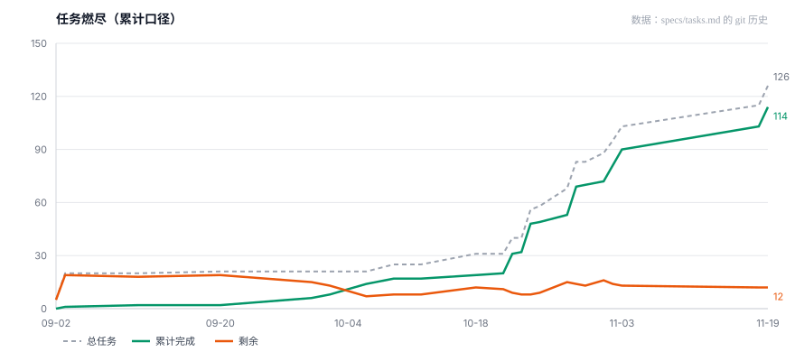

# 项目燃尽



## 怎么读这张图

- **总任务**（灰虚线）：截至该日期，`specs/tasks.md` 中已登记的任务总数。
- **累计完成**（绿线）：同一时点已勾选 `[x]` 的任务数。
- **剩余**（橙线）：总任务减累计完成。

三条线一起看才有意义。这是**开放范围**的燃尽图，不是固定迭代：

- 剩余上升通常意味着新批次任务被登记（例如新增 P0～P4 或 RAG 实施任务），不是进度倒退；
- 完成线只增不减，因为已勾选任务不会被回退勾选；
- 因此“剩余不单调下降”是正常的，判断进度要看**完成线斜率**与**新增节奏**。

## 数据

<!-- burndown:start -->

| 日期 | 总任务 | 累计完成 | 剩余 |
| --- | ---: | ---: | ---: |
| 2026-09-02 | 5 | 0 | 5 |
| 2026-09-03 | 20 | 1 | 19 |
| 2026-09-11 | 20 | 2 | 18 |
| 2026-09-20 | 21 | 2 | 19 |
| 2026-09-30 | 21 | 6 | 15 |
| 2026-10-02 | 21 | 8 | 13 |
| 2026-10-04 | 21 | 11 | 10 |
| 2026-10-06 | 21 | 14 | 7 |
| 2026-10-09 | 25 | 17 | 8 |
| 2026-10-18 | 31 | 19 | 12 |
| 2026-10-21 | 31 | 20 | 11 |
| 2026-10-22 | 40 | 31 | 9 |
| 2026-10-23 | 40 | 32 | 8 |
| 2026-10-24 | 56 | 48 | 8 |
| 2026-10-25 | 58 | 49 | 9 |
| 2026-10-28 | 68 | 53 | 15 |
| 2026-10-29 | 83 | 69 | 14 |
| 2026-10-30 | 83 | 70 | 13 |
| 2026-11-01 | 88 | 72 | 16 |
| 2026-11-02 | 95 | 81 | 14 |
| 2026-11-03 | 103 | 90 | 13 |
| 2026-11-18 | 115 | 103 | 12 |
| 2026-11-19 | 126 | 114 | 12 |

<!-- burndown:end -->

## 生成方式

```bash
node wiki/tools/burndown.mjs
```

脚本读取 `git log -- specs/tasks.md` 的历史版本，按天取最后一次快照，统计复选框数量，生成：

- `wiki/assets/burndown.svg`：图表；
- 本页数据表：仅在数值变化时输出一行。

## 口径与限制

- 统计单位是**复选框条目**，不是工时，也不区分任务大小。
- 任务被合并、拆分或改写时，总数会跳变；图反映的是清单口径，不是真实工作量。
- `specs/tasks.md` 已于 2026-11-19 从仓库跟踪中移除，之后的新勾选不再进入 git 历史；脚本会把工作区当前文件作为最后一个快照补上，但此后无法回溯每日进度。
- 需要长期保留完整燃尽历史时，应改为把任务清单重新纳入仓库跟踪，或把每日统计结果单独提交。
